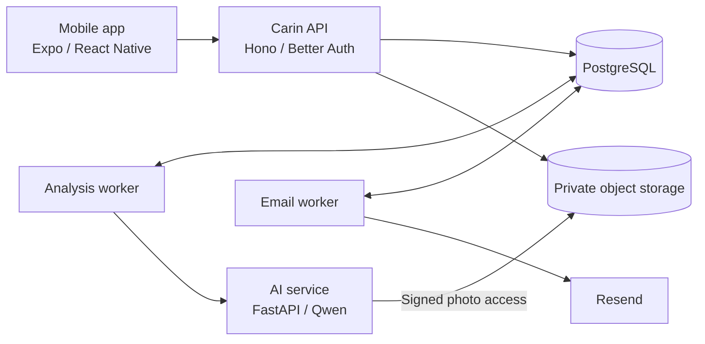

<p align="center">
  
</p>

<h1 align="center">Carin</h1>

<p align="center">
  Understand your meals. Keep track of your health.
</p>

<p align="center">
  AI-assisted meal analysis, daily nutrition tracking, and personal health records in one mobile app.
</p>

<p align="center">
  <a href="#what-you-can-do">Features</a> ·
  <a href="#how-it-works">How it works</a> ·
  <a href="#getting-started">Getting started</a> ·
  <a href="#documentation">Documentation</a>
</p>

---

Carin helps you connect everyday food choices with your health records. Take a photo before a meal to explore its estimated nutrition, or record what you ate afterward. Your dashboard, meal history, health profile, and examination records keep that information together.

Built as a hackathon MVP, Carin combines an Expo mobile app, a persistent application backend, and an internal AI service. The app requires an internet connection.

## What you can do

| Feature | What it does |
| --- | --- |
| **Scan a meal** | Take or upload a food photo to identify components and estimate portions, energy, carbohydrate, protein, fat, fiber, sugars, and sodium. |
| **Review before logging** | Review the analysis, adjust supported food and portion details, and confirm consumption before it counts toward your intake. |
| **Log meals manually** | Record consumption without taking a photo, then revisit and edit your entries. |
| **Follow your daily intake** | See today's consumption and nutrition totals, with past meals available in your history. |
| **Keep a health profile** | Record body measurements, activity, conditions, and allergies. Complete the optional profile during onboarding or return to it later. |
| **Record examinations** | Keep dated records of blood pressure, blood glucose, and cholesterol measurements taken outside the app. |
| **Manage your account** | Register with email verification, reset your password, manage AI consent, and request deletion of your account, data, and photos. |

## How it works

1. **Create an account and verify your email.** Complete your health profile now or skip it and fill it in later.
2. **Choose how to record a meal.** Scan a photo before eating or add a manual entry afterward.
3. **Review and confirm.** A photo analysis stays separate from your consumption until you confirm what you ate.
4. **Return to your records.** View daily intake, meal history, health profile, and examination entries from the app's four main tabs.

### About AI results

Photo analysis provides estimates, with source and coverage information attached to the result. Recognized foods can receive model-based nutrient estimates even when they do not match a loaded food catalog. Unknown values remain unavailable rather than being treated as zero.

Personal health assessments depend on the supported catalog and rule set; the current AI service does not issue disease-based dietary verdicts. Carin does not diagnose conditions or replace advice from a qualified health professional. See the [AI service documentation](ai-service/README.md) for the current capabilities and limitations.

## Architecture

The mobile app communicates with the Carin API. The API owns authentication, user data, private media access, and durable analysis jobs. A background worker calls the AI service; the AI service has no access to the user database.



| Component | Technologies | Location |
| --- | --- | --- |
| Mobile app | Expo, React Native, TypeScript, Expo Router, NativeWind, TanStack Query | [`carin-app/`](carin-app/) |
| API and workers | Node.js, Hono, Better Auth, Drizzle ORM, PostgreSQL | [`carin-api/`](carin-api/) |
| AI service | Python, FastAPI, Qwen vision-language models | [`ai-service/`](ai-service/) |
| Infrastructure | Docker Compose, PostgreSQL, MinIO-compatible Silo storage | [`infra/`](infra/) |
| Contracts and specifications | OpenAPI, domain rules, verification requirements | [`specs/`](specs/) |
| Model experiments | Evaluation scripts, benchmarks, and reports | [`experiments/`](experiments/) |

Meal photos are stored privately and accessed through signed URLs. AI processing requires separate consent. Analysis jobs are persisted so the app can resume checking their status after reopening.

## Getting started

### Prerequisites

- Node.js **22.12+**; Node.js **24** is recommended.
- pnpm **10.33.0**.
- Docker with Docker Compose **v2**.
- Expo Go on a phone, or an Android emulator / iOS simulator. The iOS simulator requires macOS.
- Python **3.12** and `uv` if developing the AI service outside Docker.

### 1. Configure the local environment

From the repository root, copy the templates if the destination files do not already exist:

```sh
cp -n infra/.env.example infra/.env
cp -n carin-app/.env.example carin-app/.env.local
```

Update the placeholders in `infra/.env`, including database and storage credentials, auth and media signing secrets, and the API URL reachable by your device. Configure Resend and a verified sender for account verification and password-reset emails.

In `carin-app/.env.local`, set:

```dotenv
EXPO_PUBLIC_ENV=development
EXPO_PUBLIC_API_URL=http://localhost:3000
```

For a physical phone, use your computer's reachable LAN address instead of `localhost`, or configure Android USB port forwarding. Keep the backend auth and media URLs aligned with the address the app uses. Email verification and reset callbacks require a reachable HTTPS API URL; see the [infrastructure guide](infra/README.md) for network, origin, storage-account, and email setup.

Only public client configuration belongs in `EXPO_PUBLIC_*` variables. Keep provider credentials and server secrets in the backend environment files.

### 2. Start the backend

After completing the environment and storage setup:

```sh
docker compose --profile worker --profile email \
  --env-file infra/.env -f infra/compose.yaml up --build
```

Compose runs the database migrations and starts the API, storage, analysis worker, AI service, and email worker. Check API readiness at `http://localhost:3000/health/ready`.

The local template defaults to `AI_MODE=fixture` for development. For provider-backed photo analysis, set `AI_MODE=real` and configure `AI_SERVICE_KEY`, `DASHSCOPE_API_KEY`, and `VLM_BASE_URL` in `infra/.env`. Follow the [AI setup and catalog synchronization steps](infra/README.md) before submitting real analyses. Docker Compose runs the AI service for you; a separate host process is only needed when developing it directly.

### 3. Start the mobile app

In a separate terminal:

```sh
cd carin-app
pnpm install --frozen-lockfile
pnpm run dev
```

Open the project in Expo Go using the displayed QR code, or use the Expo terminal to launch an emulator or simulator. Restart Expo after changing environment variables.

## Documentation

| Guide | Contents |
| --- | --- |
| [Local infrastructure](infra/README.md) | Environment setup, device networking, email delivery, workers, and catalog synchronization |
| [AI service](ai-service/README.md) | Analysis behavior, model integration, API routes, source attribution, and limitations |
| [Database](carin-api/docs/database.md) | Persistence and schema guidance |
| [Product specifications](specs/00-mvp-scope-and-decisions.md) | MVP scope, UX flows, architecture, and domain decisions |
| [App API contract](specs/contracts/app-api.openapi.yaml) | Mobile-to-backend endpoints and payloads |
| [AI API contract](specs/contracts/ai-service.openapi.yaml) | Internal AI endpoints and shared result schemas |
| [Verification and deployment](specs/05-verification-and-deployment.md) | Test requirements, environment boundaries, and release checks |
| [Model evaluation](experiments/README.md) | Experimental methods and evaluation artifacts |

For development checks, the mobile and API packages each provide `typecheck`, `lint`, `test:unit`, and `test:integration` scripts. The AI service uses `uv run pytest`. Run commands from the corresponding module directory; the verification guide covers cross-service and contract checks.
