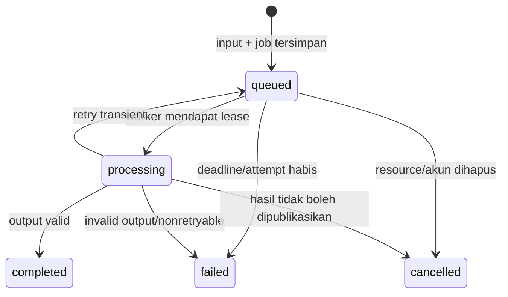

# Carin — domain dan aturan bisnis

Versi 1.0.0. Schema wire ada di `contracts/`; tabel di bawah adalah target Drizzle.

## Entity dan ownership

| Entity | Isi dan aturan |
| --- | --- |
| Better Auth user/account/session/verification | Schema milik Better Auth; tambahan DOB, accepted legal versions/timestamp dan status deletion. Password hanya melalui library auth. |
| health_profile | Satu row per user; version integer; field opsional dan knowledge states eksplisit |
| profile_snapshot | Context minimal immutable, diambil dari profile version saat analisis/record dibuat |
| consent_event | user, jenis, versi, granted/revoked, waktu server; nilai legal registry menentukan versi aktif |
| catalog_food | Catalog ID/version, cara saji, gizi per 100 g, takaran gram, source refs. Tidak berisi user data. |
| photo | user, object key acak, checksum, MIME, size, lifecycle; satu foto milik satu root scan |
| analysis_job | user, operation ID, jenis, input snapshot, lease/attempts, state, error, target generation |
| analysis_result | Immutable validated output; profile/catalog/rule versions, provenance, waktu selesai |
| scan | user, photo, revision saat ini, job/result refs, lifecycle; koreksi menambah revision |
| consumption | user, revision, source, optional scan ID, consumedAt/timezone, current immutable snapshot |
| consumption_snapshot | Komponen aktual, gizi/provenance, profil/acuan, personal evaluation state/result |
| examination | user, revision, tipe/subtipe/konteks, date/time precision, nilai/unit, catatan |
| idempotency_record | user/session action scope + key, request hash, response/resource; 24 jam |
| deletion_task/email_task | Outbox/job metadata untuk cleanup dan email; payload sensitif dibatasi |

User-owned tables memakai `user_id` non-null dengan FK dan filter ownership di
semua read/write. ID resource adalah UUID opaque. Client tidak memilih `userId`.
Resource milik pengguna lain dan resource terhapus menghasilkan 404 yang sama.
FK dan transaction memastikan referensi tidak menyeberang user.

Version/revision mulai 1. PATCH menggunakan `expectedRevision`; mismatch 409
`REVISION_CONFLICT`, tidak last-write-wins diam-diam. Profile uses `version` dengan
aturan sama. Server menghitung `createdAt`/`updatedAt`; client mengisi event time.

Constraint/index minimum: unique health_profile(user_id), catalog_food(version,id),
analysis_result(job_id), dan default confirmation(scan_id) untuk consumption aktif;
index job(status,next_attempt_at), consumption(user_id,consumed_at,id),
examination(user_id,series_key,measured_on,id), serta scan(user_id,created_at,id).
Referensi antar resource milik user memakai composite ownership FK atau validasi
transaction dengan lock, bukan pengecekan client. Snapshot JSONB immutable;
revision aktif hanya berubah di transaction yang sama dengan snapshot/job pointer.

## Usia dan profil

DOB adalah ISO date-only. Server menghitung usia kalender saat registrasi di
Asia/Jakarta: selisih tahun dikurangi satu jika bulan/tanggal ulang tahun belum
lewat; 29 Februari dianggap belum berulang tahun sampai 1 Maret pada tahun nonleap.
Terima 18 ≤ age ≤ 50, tolak tanggal masa depan dan out-of-range. Tidak memakai
angka usia yang disuplai client sebagai bukti validasi. Tidak ada verifikasi ID.

DOB tersimpan pada akun dan read-only P0. Age admission tidak diulang untuk login;
akun tidak hilang ketika berusia 51. AI context memakai usia terbaru, bukan usia
registrasi. Personalization methods tetap mengikuti rentang usia yang didukung.

Field numerik profil bisa null; nilai terisi harus finite dan positif. Sex for
reference nullable; hanya metode yang memerlukannya memakai input tersebut.
Diagnosis knowledge state: `not_provided`, `none_known`, `never_examined`, `reported`.
Reported memerlukan daftar kondisi; state lain memerlukan daftar kosong.
Family history: `not_provided`, `unknown`, `none_known`, `reported`.
Allergy: `not_provided`, `unknown`, `none_known`, `reported`.

Kondisi lain menggunakan ID input acak dan label, dengan conditionId null. Teks
tidak dipadankan diam-diam menjadi diagnosis katalog. Kondisi katalog yang dipilih
juga belum tentu didukung personalisasi. `never_examined` bukan diagnosis sehat.
Pemeriksaan terbaru berasal dari tabel examination, bukan field profile.

## Porsi, makanan, dan perhitungan

Component input berisi ID stabil dalam draft, displayName, catalogFoodId nullable,
preparation nullable, dan portion. Portion `known` mempunyai quantity > 0 dan
unit `g` atau `serving`; unit serving mewajibkan servingId katalog. Portion
`unknown` tidak mempunyai angka. Takaran `mangkuk`, `potong`, dll hanya valid jika
terdapat servingId dengan berat gram dan sumber. Tidak membuat berat generik.

P0 memakai berat bagian edible dalam gram. Nilai gizi per komponen untuk zat N:
`N_per_100g × edible_grams / 100`. Gram = quantity untuk unit g; untuk serving,
gram = quantity × katalog serving. Tanpa matched catalog ID/version, sumber N,
atau porsi yang dapat dipetakan, nilai N null. Nol hanya boleh berasal dari
sumber yang secara eksplisit bernilai nol.

Fixed nutrient keys: `energyKcal`, `carbohydrateG`, `proteinG`, `fatG`, `fiberG`,
`sugarsG`, `sodiumMg`. Jangan mengisi gula dari karbohidrat atau natrium dari garam.
Catalog numeric data menggunakan numeric/decimal DB; simpan hasil kalkulasi
dengan presisi maksimum enam desimal. Wire dapat memakai JSON number finite.
UI membulatkan energi/natrium ke satu desimal dan zat gram ke dua desimal;
agregasi memakai nilai belum dibulatkan. Toleransi uji kontrak 0.000001.

Total per zat menjumlah hanya nilai diketahui. Coverage per zat memuat
knownComponentCount dan totalComponentCount. Jika tidak ada yang diketahui,
total null, bukan 0. Jika sebagian diketahui, tampilkan nilai dengan label
parsial. Total yang benar-benar nol tetap dapat diketahui dengan coverage > 0.

Source refs mencakup dataset ID/version, item/basis, citation URL jika tersedia.
Katalog immutable per versi. Backend menyimpan versi yang digunakan snapshot;
update katalog tidak mengubah angka/perhatian historis.

Save/edit konsumsi dan koreksi mengirim `catalogVersion` yang digunakan saat
memilih food/serving. Server tidak mengganti versi diam-diam. Versi yang tidak
tersedia ditolak 409 `CATALOG_VERSION_UNAVAILABLE`, dengan draft tetap dipertahankan.
Komponen bebas memakai catalogFoodId null; tidak perlu membuat food ID palsu.
Jika katalog belum diimpor, manual boleh memakai catalogVersion `unavailable`
dengan semua komponen unmatched. Snapshot berisi gizi null dan limitation;
personal evaluation not_requested. Sentinel ini tidak dikirim sebagai versi AI.

## Lifecycle scan, koreksi, dan job

`completed` memuat result supportStatus `complete`, `partial`, atau `unrecognized`.
`failed` memuat error tanpa result. Lifecycle job berbeda dari overallAttention.
Cancelled berarti publikasi dibatalkan; provider call yang telanjur berjalan boleh
selesai, tetapi hasil dibuang dan tidak menghidupkan resource yang dihapus.

Scan menyimpan hasil meski belum dikonsumsi sehingga dapat dibuka kembali. Revision
scan menunjuk hasil terakhir yang berhasil; job koreksi menargetkan revision
berikutnya dengan `basedOnResultId` dan latestJobId yang baru. Scan baru dimulai
revision 1 meskipun result masih null; initial job menargetkan revision 1.
Current result dan
revision berubah hanya jika expectedRevision masih cocok dan output terbaru valid.
Koreksi gagal tidak menimpa hasil sah sebelumnya; draft baru tetap jelas belum
terhitung. Profil untuk koreksi memakai snapshot scan awal, sehingga hanya
pengaruh makanan/porsi berubah. Analisis dengan profil baru adalah scan baru.

Konfirmasi saat koreksi aktif ditolak 409 `ANALYSIS_PENDING`; hasil lama tidak
dikonfirmasi tanpa sengaja. Setelah koreksi gagal, user dapat kembali ke hasil
lama secara eksplisit atau retry draft. basedOnResultId harus current result;
catalogVersion koreksi harus versi result tersebut.

Correction yang bersaing ditolak 409 jika revision/job aktif berbeda. Bila worker
lama selesai setelah deletion/edit, generation guard menolak publikasinya.
Backend tidak menerima nilai gizi/attention kiriman mobile sebagai hasil sah.
Setiap claim/lease mempunyai fencing token baru. Publish memeriksa status processing,
token/attempt lease aktif, target generation, ownership, deletion, dan consent
dalam satu transaction; respons attempt lama setelah reclaim dibuang meskipun
operation ID dan target revision sama. Satu job maksimal mempunyai satu result.

## Konsumsi dan evaluasi personal

Source `manual` tidak mempunyai scanId; `photo_confirmation` harus merujuk scan
dan hasil/revision valid milik user. Nama minimal satu komponen, consumedAt dan
timezone wajib. Porsi boleh unknown. Event makan tidak boleh di masa depan lebih
dari toleransi clock skew lima menit. Backdating didukung.

Server membuat nutrition snapshot dari katalog/sumber yang cocok dan input aktual.
Komponen manual unmatched tetap tersimpan tanpa gizi. Untuk konfirmasi foto,
gunakan komponen hasil terbaru yang dipilih; perubahan porsi aktual dihitung
ulang, tidak menyalin total sebelum perubahan. Jenis/cara saji baru wajib
menggunakan food ID/sumber baru atau null.

Untuk komponen unmatched/unrecognized dari hasil foto yang sama, server boleh
membawa estimasi per komponen dengan provenance `model_estimate` ke snapshot
konsumsi. Jika gram sumber dan gram aktual tersedia, server menerapkan rasionya;
jika tidak, input harus menyertakan `photoPortionFraction` positif (1 berarti
seluruh porsi pada foto). Nilai yang null tetap null dan hasil tidak pernah
diubah menjadi nilai per 100 g. Perubahan nama, makanan katalog, atau cara saji
membatalkan pemakaian estimasi foto tersebut. Snapshot mencatat faktor yang
diterapkan. Estimasi visual tidak mendukung status katalog atau evaluasi personal.

Analisis dan konsumsi memiliki lifecycle terpisah: analisis tidak membuat catatan
konsumsi. Satu hasil analisis dapat terkait dengan nol atau beberapa kejadian
konsumsi. Dashboard asupan hanya menjumlahkan snapshot konsumsi aktif.

Save consumption atomik dan dapat berhasil meskipun AI tidak tersedia. Bila profil,
consent, dan data mendukung, server menjadwalkan evaluation job terhadap snapshot
input/profil/acuan pada save tersebut. Attention state `pending`; result sah
menyelesaikan initial evaluation untuk generation itu. Ini bukan analisis ulang
histori dengan profil baru. Failure memberi state `failed` dengan gizi tersimpan
tetap utuh. Retry memakai input snapshot yang sama. Bila tidak eligible,
state `not_requested` dengan missingData/unsupported/consent explanation.

Jika konfirmasi foto memakai makanan/porsi dan profil snapshot yang sama dengan
result sah, perhatian dapat dipakai kembali tanpa call. Porsi berbeda harus
dievaluasi terhadap porsi aktual. Edit membuat revision dan evaluation baru;
hasil lama tetap immutable, tetapi bukan snapshot aktif. Job lama tidak dapat
menimpa revision baru. Setelah initial evaluation selesai, perubahan profile/
dataset tidak memperbarui histori otomatis.

Save berulang memakai Idempotency-Key yang sama. Satu scan mempunyai default
confirmation consumption tunggal melalui unique constraint. Bila record sudah
ada, kembalikan record itu untuk request identik, atau 409 untuk input berbeda
dengan arahan edit. Pengguna dapat memilih `new_occurrence` untuk konsumsi baru
dari scan yang sama; ini aksi terpisah dengan key baru. Tidak deduplicate dua
makanan berbeda hanya karena nama/waktunya mirip. Setelah consumption dihapus,
scan boleh dikonfirmasi lagi dengan key baru sebagai tindakan eksplisit.

Replay key yang sama mengembalikan status/body asli (termasuk 201). Key baru untuk
default confirmation yang sudah ada dan input identik mengembalikan 200 record
existing; payload berbeda 409 `CONSUMPTION_ALREADY_CONFIRMED`. Perbandingan memakai
input canonical, bukan snapshot attention yang mungkin selesai setelah save.

## Dashboard

Default date memakai timezone akun. Hari ini = interval [awal hari, awal hari
berikutnya) yang dikonversi server ke UTC. Perhatian tujuh hari = enam hari
sebelumnya + hari ini; tanggal awal/akhir dan timezone dikirimkan pada response.
Manual/foto masuk berdasarkan consumedAt, bukan uploadedAt/createdAt.

- consumptionCount menghitung record makan; componentCount menghitung komponen.
- Nutrition coverage dan sum dihitung per zat dari snapshot aktif consumption,
  bukan seluruh scan. Catatan tanpa gizi tetap menambah jumlah catatan.
- Perhatian berulang dikelompokkan menurut `(ruleId, conditionId)` yang stabil.
  Hitung maksimal sekali per consumption aktif; beberapa komponen bukan kejadian
  ganda. Tampilkan grup dengan count ≥ 2, window, dan seluruh consumption IDs.
  Pending/failed/unavailable assessment tidak dihitung sebagai perhatian.
- Pemeriksaan terakhir dipilih per comparable series key, bukan satu nilai
  campuran. Date/time pengukuran menentukan urutan; createdAt hanya tie-breaker.
- Save/edit/delete dan selesainya initial evaluation pada consumption mengubah
  ringkasan. Scan-only tidak mengubah asupan atau recurring attention.
- Dashboard cache diinvalidasi oleh mutation/event terkait. Response berasal
  dari snapshot DB konsisten; user tidak dianggap mencatat seluruh asupan.

## Pemeriksaan

Tipe P0: pressure (systolic/diastolic mmHg), glucose (mg/dL; fasting/random/
post_meal/unknown), cholesterol (total/ldl/hdl mg/dL). Numeric > 0; tekanan darah
bilangan bulat. Preview konfirmasi setiap pemeriksaan menampilkan nilai, unit,
tanggal dan konteks agar user memeriksa input. Tanpa acuan threshold yang disetujui,
P0 tidak mengklasifikasikan angka sebagai abnormal atau mengoreksinya otomatis;
nilai positif tidak ditolak hanya berdasarkan kisaran klinis. Tidak ada diagnosis/triase.

`measuredOn` date-only wajib; `measuredTime` HH:mm nullable dan timezone wajib.
Tanpa waktu, precision adalah date-only; tidak membuat midnight sebagai waktu
aktual. Date/time masa depan ditolak berdasarkan timezone yang dilaporkan.
Simpan createdAt terpisah. Date-only pada tanggal sama diurutkan createdAt/id
untuk determinisme tanpa mengklaim urutan pengukuran yang tidak diketahui.

Series key = tipe + subtype/context + unit. Sistolik/diastolik dua garis dalam
seri pressure; glucose context berbeda, cholesterol subtype berbeda tidak
digabung. Grafik satu data menampilkan satu titik. Tidak ada kata membaik/
memburuk otomatis. Edit/delete memengaruhi latest dan grafik, bukan row lain.

## Penghapusan dan foto

Root scan memiliki foto. Koreksi dan consumption foto merujuk root scan, tidak
menduplikasi object. Hapus consumption menghilangkan snapshot aktif/evaluasi dan
ringkasan, tetapi scan yang masih disimpan pengguna tetap memiliki fotonya.
Hapus scan tidak menghapus consumption: foto dihapus, consumption menyimpan
nutrition/provenance snapshot dan menampilkan `foto sumber telah dihapus`.
Hapus scan membatalkan job aktif; consumption terkait yang sudah mempunyai
snapshot tetap utuh. Tindakan UI menjelaskan konsekuensi ini.
Saat scan/result dipurge, FK nullable scanId/sourceAnalysisResultId pada consumption
menjadi null; source tetap photo_confirmation, photoAvailable false. Snapshot
mempertahankan provenance versi, bukan bergantung pada row result yang sudah dihapus.

Resource terhapus langsung dikecualikan dari API/perhitungan dalam transaction.
MinIO deletion dilakukan cleanup outbox dengan retry; target P0 ≤ 24 jam.
Object tidak menjadi publik selama menunggu cleanup. Upload tanpa scan dibersihkan
setelah satu jam. Normalized photo hasil scan tetap disimpan sampai scan atau
akun dihapus; tidak ada auto-expiry scan P0. File raw dihapus setelah normalisasi.

Account deletion: verifikasi password kembali; revoke sessions dan blok akses
atomik; purge seluruh user data dan MinIO objects melalui durable task. Simpan
tombstone minimal/deletion job sampai cleanup selesai; hapus payload job setelah
sukses. Job tak dapat membangkitkan user data kembali. Cache mobile dibersihkan.
Retensi backup/compliance formal bukan release claim MVP dan tidak dijanjikan
sebagai penghapusan instan dari snapshot backup.
