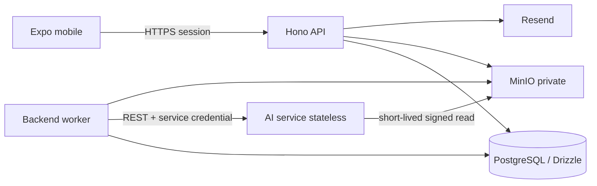

# Carin — arsitektur sistem

Versi 1.0.0. Struktur target saat implementasi: `carin-app/`, `backend/`,
`ai-service/`, `specs/`. Bahasa/framework internal AI tetap keputusan tim AI;
REST contract tidak bergantung pada pilihan tersebut.

## Komponen

Backend API dan worker berasal dari image/codebase yang sama dengan entrypoint
terpisah. PostgreSQL menyimpan job durable dan application/auth data. AI service
tidak memperoleh database URL, user session, userId, email, atau akses bucket
umum. Foto memakai signed read URL untuk satu object dan lifetime terbatas.

## Batas modul

Backend memiliki auth, legal/consent, profile, catalog, media, analyses, consumptions,
examinations, dashboard, dan account-deletion. Setiap modul memisahkan HTTP handler,
schema validation, application service/transaction, dan repository. Domain helpers
untuk timezone, portion math, coverage, series keys, dan status tidak bergantung
pada Hono/DB. Worker menggunakan application service yang sama, bukan memanggil
API publik sebagai pengguna.

Mobile memakai Expo Router untuk routes, feature containers/hooks untuk orchestration,
typed API repository untuk data, dan reusable presentational components. Server
state memakai TanStack Query; session melalui Better Auth client. Draft form di
memory dan persisted draft seperlunya, dinamespace userId/environment dan dibersihkan
pada logout. Credentials di SecureStore; response cache tidak menjadi auth proof.

DB migrations dikelola Drizzle. Schema Better Auth dibuat dari konfigurasi/pinned
package saat implementasi, lalu dimasukkan migrations yang direview bersama
application schema. Jangan edit tabel auth di luar integrasi library.
[Dokumentasi adapter Drizzle](https://better-auth.com/docs/adapters/drizzle).

## Auth dan email

Mount handler Better Auth pada `/api/auth/*`; custom resource API pada `/api/v1/*`.
Middleware membaca sesi server dan ownership, tidak hanya cached user mobile.
Hono dapat memasang handler Better Auth langsung.
[Integrasi Hono](https://better-auth.com/docs/integrations/hono).

Gunakan session Better Auth (DB-backed); konfigurasi P0: email/password, require
verified email, signup tidak auto-login, verification tidak auto-login, umur
session tujuh hari/update harian, password 8–128 karakter, revoke sesi saat reset.
Verification/reset link expiry satu jam. Hook register memvalidasi DOB/usia serta
legal versions pada endpoint vendor sendiri sehingga raw endpoint tidak dapat
melewati admission checks. additional fields menyimpan DOB, acceptedTermsVersion,
acceptedPrivacyVersion, acceptedAt server-only. Profil dapat dibuat lazily saat
first read tanpa row duplikat.
Semua ID auth/application dikonfigurasi UUID, termasuk
`advanced.database.generateId: "uuid"` Better Auth, agar cocok dengan kontrak Me.
DOB/legal metadata tidak dapat diubah melalui raw update-user: field dibuat
non-updateable dan hook memblokir bypass. Nonaktifkan vendor delete-user endpoint;
penghapusan akun hanya melalui workflow Carin agar storage dan jobs ikut dibersihkan.
Aktifkan rate limit auth; resend mempunyai cooldown 60 detik dan feedback generik
untuk request reset/verification agar tidak membocorkan keberadaan akun.
[Email dan password](https://better-auth.com/docs/authentication/email-password),
[opsi konfigurasi](https://better-auth.com/docs/reference/options).

Client Expo memakai `@better-auth/expo/client` dengan SecureStore; server memasang
plugin Expo. API fetch non-auth mengirim cookie sesi yang diperoleh client.
Cookie prefix/storage prefix dan deep-link scheme berbeda per environment.
Origins/callback hanya allowlist; permissive Expo origins hanya development.
Dokumentasi integrasi yang diperiksa memakai SDK 55, sedangkan repo memakai SDK 56:
uji email/password, cookie persistence, dan deep link pada build repo aktual.
[Integrasi Expo](https://better-auth.com/docs/integrations/expo).

| Vendor endpoint | Pemakaian mobile |
| --- | --- |
| POST `/api/auth/sign-up/email` | name, email, password, birthDate, acceptedTermsVersion, acceptedPrivacyVersion |
| POST `/api/auth/sign-in/email` | email, password; no application session untuk email unverified |
| POST `/api/auth/sign-out` | Revoke current session; clear local cache |
| GET `/api/auth/get-session` | Revalidate session setelah launch/resume |
| POST `/api/auth/send-verification-email` | email + allowlisted callback URL |
| GET `/api/auth/verify-email` | token + callback; hasil HTTPS landing page |
| POST `/api/auth/request-password-reset` | email + allowlisted redirectTo |
| POST `/api/auth/reset-password` | token + newPassword |

Route/payload vendor menggunakan SDK dan schema dari versi Better Auth yang
dipin saat implementasi. App OpenAPI mencakup resource Carin; tidak menulis ulang
raw response vendor menjadi kontrak buatan. Gate auth memverifikasi table di atas
terhadap schema OpenAPI yang dihasilkan integrasi Better Auth sebelum auth feature
dianggap selesai. Custom registration hook dan curated `/api/v1/me` tetap kontrak
Carin. Tidak membuat auth/refresh layer kedua.

Resend API key hanya backend. Hook email menyerahkan delivery ke outbox worker
tanpa membuat response reset bergantung pada keberadaan email. Verification/reset
delivery retry memakai delivery key yang stabil; token tidak masuk log umum.
Task sukses dihapus; token task expiry mengikuti token library. Domain pengirim
harus verified untuk penerima uji yang diperlukan.
[Verified domains Resend](https://resend.com/docs/dashboard/domains/introduction).

Backend menyediakan landing routes `/auth/verified` dan `/auth/reset` untuk
email. Reset landing menampilkan tombol membuka scheme app environment; tidak
menerima callback arbitrer dari query. Token/query tidak dicatat access log,
Referrer-Policy no-referrer dan cache no-store berlaku pada halaman tersebut.
Build native/development build digunakan untuk acceptance deep links, bukan
menganggap Expo Go membuktikan semua callback produksi.

## Cache, HTTP, dan consistency

Online-required: mutation menunggu respons server; tidak ada offline sync queue.
Cache read ditandai stale/offline; draft disimpan hanya untuk menjaga input.
401 membersihkan session dan mengarahkan login, tetapi draft pengguna tidak
ditransfer ke akun lain. Query/mutation keys scoped oleh environment/user ID.
Setelah login baru, refetch `/me`, profile, dashboard; clear cache saat logout.

App OpenAPI memakai cookie security scheme konseptual; actual cookie name mengikuti
prefix Better Auth environment. Respons custom memakai error envelope konsisten.
ID resource asing menghasilkan 404. Mutation retry menggunakan Idempotency-Key
UUID yang dibuat satu kali per aksi. Key yang sama + payload berbeda: 409.
Simpan request hash/resource dan response selama 24 jam. Profile update memakai
version; consumption/exam edit memakai expectedRevision.

List memakai cursor opaque yang mengikat owner/filter/sort/version, bukan offset.
Urutan konsumsi consumedAt DESC/id DESC, scan createdAt DESC/id DESC; pemeriksaan
measuredOn DESC/measuredTime DESC NULLS LAST/createdAt DESC/id DESC. Katalog memakai
displayName/id stabil dalam versi. from inklusif/to eksklusif; range invalid 422.
Error codes minimum: INVALID_INPUT (400/422), UNAUTHENTICATED (401),
EMAIL_NOT_VERIFIED/AI_CONSENT_REQUIRED (403), RESOURCE_NOT_FOUND (404),
REVISION_CONFLICT/IDEMPOTENCY_CONFLICT/ANALYSIS_PENDING/
CONSUMPTION_ALREADY_CONFIRMED/CATALOG_VERSION_UNAVAILABLE (409),
RATE_LIMITED (429 + Retry-After), SERVICE_UNAVAILABLE (503).
Error retryable true hanya untuk kegagalan sementara; jangan retry validation/
ownership/consent secara otomatis. Unexpected 5xx memakai envelope yang sama,
tanpa stack trace atau body sensitif.

## Media dan job AI

1. Mobile unggah multipart JPEG/PNG ke backend. Validasi ukuran/MIME dan decode
   nyata, strip EXIF, normalize, simpan private object; response photoId.
2. Mobile membuat analysis job dengan photoId dan key; backend mengikat photo ke
   scan, mengambil profile snapshot, membuat job dalam transaction, mengembalikan 202.
3. Worker claim row menggunakan lock/lease; kirim request ke AI endpoint synchronous
   internal. Async job ownership berada di backend, bukan state di AI service.
4. AI memproses signed URL dari allowlisted MinIO host atau components pada
   recalculation. AI mengembalikan structured output; backend validate schema,
   operation/profile/catalog versions, source refs, totals/coverage dan rules.
5. Worker publish result dan job state dalam transaction setelah lease fencing,
   generation/deletion/consent guard. Invalid output tidak dipublikasikan sebagai
   hasil sebagian sah; respons attempt lama tidak menimpa attempt aktif.
6. Mobile poll detail job saat layar/app aktif; detail/riwayat refetch saat resume.

P0 budgets yang dipilih: AI call 90 detik; backend job overall deadline 5 menit;
max tiga attempt untuk transient failure dengan delay 2 dan 10 detik; lease
120 detik dengan heartbeat. Worker restart memulihkan expired lease. Provider
call boleh diulang setelah crash; publishing idempotent berdasarkan operation ID.
AI request tetap stateless, operation ID untuk correlation bukan DB user access.
Heartbeat/complete hanya boleh mengubah row dengan lease token yang masih cocok.
Crash setelah result commit dipulihkan sebagai completed, tidak memanggil AI lagi.

Polling mobile: 2 detik awal, lalu 5 detik setelah 30 detik; berhenti saat terminal
state/background. Limit default dua job aktif per user; response 429 mencantumkan
Retry-After. Deployment worker concurrency default dua, dapat dikonfigurasi.
Tidak ada push/SSE P0. Retry terminal job lewat endpoint retry memakai snapshot
lama dan job baru; tidak diam-diam mengambil profile baru.

Backend mengimpor versioned food catalog dari internal AI catalog endpoint dan
menyimpannya di PostgreSQL. Catalog adalah reference data packaged di AI service,
bukan user state. Backend dapat mencari dan menghitung gizi manual tanpa AI call
setelah import; personal attention tetap di AI service. Katalog/serving math sama
dengan spec domain dan diuji silang. Jika catalog belum tersedia, input manual
tetap dapat disimpan sebagai unmatched, tanpa angka tebakan.
Katalog lama tetap tersedia untuk draft/koreksi/snapshot yang menunjuk versinya.
Search dapat meminta versi tertentu; response selalu membawa catalogVersion.
Manual save tanpa katalog memakai sentinel `unavailable` dan hanya komponen
unmatched; sentinel ini bukan versi data gizi dan tidak dikirim ke AI untuk evaluasi.

## Consent, akses, dan cleanup

Terms/privacy mandatory register; `ai_processing` consent optional dan versioned.
Tanpa consent AI, profile/exams/manual record tetap berfungsi; photo analysis dan
personal evaluation menampilkan consent action. Withdrawal menghentikan job AI
baru serta publication job aktif; histori tersimpan tidak dihapus otomatis.
Transaction withdrawal menandai job aktif cancelled; re-grant tidak menghidupkan
job tersebut kembali. Consumption yang menunggu evaluasi menjadi not_requested
dengan consent limitation; gizi tetap tersimpan. Retry memerlukan consent aktif.
User dapat menghapus scan/akun. AI requests hanya mengirim context yang diperlukan,
tidak DOB, email, free-form clinician notes, atau exams P0.

MinIO hanya di private network. Backend membuat signed view URL lifetime lima
menit untuk pemilik yang sah pada `/media/photos/{photoId}` di origin API publik.
Opaque grant ditandatangani server, mengikat photo/user/environment/expiry;
handler memvalidasi grant dan status resource/akun sebelum stream object. URL
adalah bearer capability, bukan public bucket; jangan log query grant. Endpoint
ini tidak membutuhkan cookie agar image loader mobile dapat membukanya. Deletion
menolak grant lama segera; respons media memakai Cache-Control private, no-store.
AI URL adalah presigned MinIO internal sepuluh menit, diperbarui per attempt.
AI tidak diberi bucket credentials. Log memakai request/job ID dan error code,
tanpa foto, nilai pemeriksaan, diagnosis, cookie, token, atau body pribadi.

DB deletion dan object deletion berbeda transaction boundary. Durable outbox
memastikan cleanup tetap berjalan setelah crash. Account deletion memberi 202
setelah sessions revoked dan data tidak bisa diakses; task melakukan purge dan
retry MinIO sampai selesai. Tidak mengklaim object sudah terhapus ketika baru queued.

## Environment

`APP_ENV` dev/staging/prod menentukan konfigurasi eksplisit. Secrets: DB URL,
Better Auth secret, Resend key, MinIO credential, dan AI service key tidak masuk
Expo public env. Mobile hanya menerima API base URL dan scheme. Production/staging
endpoint HTTPS; local native memakai IP LAN/emulator yang reachable, bukan
`localhost` ponsel. DB/MinIO/AI tidak dipublikasikan di internet lewat port Compose.
Lihat deployment spec untuk variabel dan acceptance gates.
