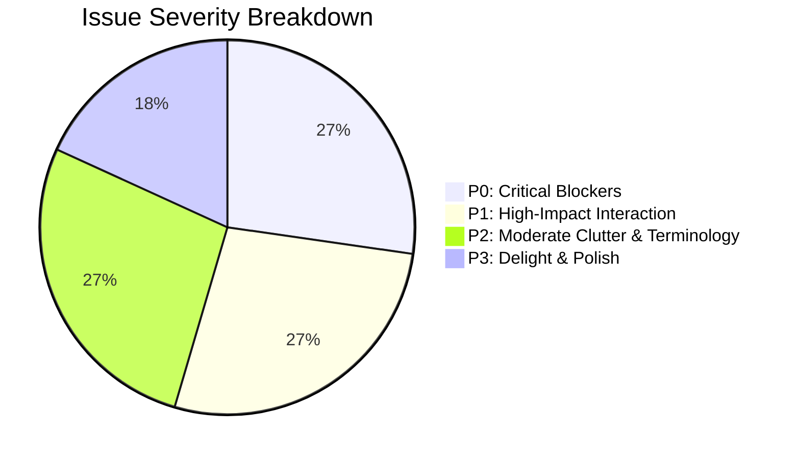

# Suite 5 Critique: Health Examination Form, Health Profile Onboarding & Auth Suite

**Evaluator:** Elite Adversarial UI/UX Critic & Mobile Product Architect  
**Evaluation Scope:**
- `carin-app/components/app/form-field.tsx`
- `carin-app/app/exams/new.tsx`
- `carin-app/components/exams/ExaminationForm.tsx`
- `carin-app/app/exams/[id].tsx`
- `carin-app/app/exams/[id]/edit.tsx`
- `carin-app/components/exams/ExaminationSeriesChart.tsx`
- `carin-app/app/(onboarding)/health-profile.tsx`
- `carin-app/app/(auth)/sign-in.tsx`
- `carin-app/app/(auth)/sign-up.tsx`
- `carin-app/app/(auth)/forgot-password.tsx`
- `carin-app/app/(auth)/reset-password.tsx`
- `carin-app/components/auth/auth-screen.tsx`

---

## 1. Overall Impression & Anti-Patterns Verdict

### AI Slop Verdict: **Guilty of Severe Card Clutter, Monolithic Form Fatigue & Clunky Web-First Reflexes**

Suite 5 demonstrates solid state management, robust revision conflict handling, and strict adherence to Carin's non-judgmental philosophy (e.g. *"Angka ditampilkan sebagai catatan pengukuran, tanpa penilaian klinis"*). However, from a mobile product and visual design perspective, it suffers from several acute anti-patterns:

1. **Card-for-Everything AI Slop Reflex:**
   - In `health-profile.tsx`, 6 identical `rounded-summary border border-border bg-card` containers are stacked one after another down a 740-line monolithic screen.
   - In `ExaminationForm.tsx`, inputs are arbitrarily partitioned into disconnected floating card boxes (Systolic/Diastolic in Card 1, Date/Time in Card 2, Note floating outside, and Preview in Card 3).
   - In `auth-screen.tsx`, mobile authentication flows are trapped inside a desktop-style floating card box (`p-6 border border-border bg-card`), sacrificing native full-bleed fluidity.
2. **The "Hostage Onboarding" Skip Flaw:**
   - Carin's non-negotiable domain invariant states: *Health profile is explicitly optional*. Yet on `health-profile.tsx`, the "Isi nanti" button is buried at the extreme bottom of a massive 2000px scroll view (line 734). There is no "Lewati" or close button in the top navigation bar. A new user is held visual hostage until they scroll past 20+ fields.
3. **The Two-Step Confirmation Preview Anti-Pattern:**
   - Submitting an examination does not save the vital log. Instead, tapping the primary button abruptly expands an inline preview card at the bottom of the scroll view (`preview ? ... : ...`), requiring the user to scroll down and tap *"Konfirmasi dan simpan"* a second time. This causes severe content jumping and doubles input friction for daily logging.
4. **Hardcoded Color Hexes & Broken Dark Mode Tokens:**
   - `form-field.tsx` and `ExaminationForm.tsx` hardcode `placeholderTextColor="#8a8d80"`.
   - `ExaminationSeriesChart.tsx` hardcodes `#506B35`, `#4f78a8`, and `#d1cebd` directly in SVG lines, circles, and legends, alongside static layout constants (`WIDTH = 340`, `HEIGHT = 180`). In dark mode, these colors clash with the dark olive palette and lack contrast.
5. **Ergonomic Blindspots:**
   - Password fields have no show/hide eye toggle across all auth screens (`sign-in.tsx`, `sign-up.tsx`, `reset-password.tsx`).
   - Blood pressure inputs use `decimal-pad` instead of integer `number-pad`.
   - Date of birth in `sign-up.tsx` and exam time in `ExaminationForm.tsx` require manual keyboard text typing of punctuation and formatting (`YYYY-MM-DD` and `HH:mm`).

---

## 2. Nielsen's 10 Usability Heuristics Scorecard

| # | Heuristic | Score (0–4) | Key Finding & Evaluation |
|---|---|:---:|---|
| **1** | **Visibility of System Status** | **2 / 4** | Submitting an exam triggers an inline preview expansion that shifts the viewport instead of providing a clear modal or sticky action. Password reset feedback in `forgot-password.tsx` is an understated 1-line muted caption with no visual transition to a sent state. |
| **2** | **Match Between System & Real World** | **2 / 4** | Database schema enums leak into user-facing copy: *"Pengetahuan diagnosis"*, *"none_known"*, *"never_examined"*, *"reported"*. Blood pressure is split into vertical full-width cards rather than the universally recognized paired format (`120/80 mmHg`). |
| **3** | **User Control & Freedom** | **1 / 4** | **CRITICAL DEFECT:** In `health-profile.tsx`, the skip affordance (*"Isi nanti"*) is buried at the bottom of a 6-card scroll view with zero skip action in the header. Delete confirmation in `exams/[id].tsx` is an inlined card that appears below the fold. |
| **4** | **Consistency & Standards** | **2 / 4** | Inconsistent date pickers: `ExaminationForm` uses `@react-native-community/datetimepicker`, while `sign-up.tsx` forces raw text typing of `YYYY-MM-DD`. Navigation buttons use non-standard text glyphs (`‹ Kembali ke pemeriksaan`) and call `router.replace` unconditionally. |
| **5** | **Error Prevention** | **2 / 4** | `decimal-pad` on blood pressure allows entering invalid decimal dots. Raw text typing for birthdates invites parsing failures. Blind password fields without eye toggles lead to frequent credential typos. |
| **6** | **Recognition Rather than Recall** | **2 / 4** | Users must recall time formats (`HH:mm`) and manually type colons. In `health-profile.tsx`, users are forced to recall all medical conditions and family relations in open-ended text fields. |
| **7** | **Flexibility & Efficiency of Use** | **2 / 4** | Two-step confirmation preview in `ExaminationForm` penalizes frequent logging. No quick-fill shortcuts (e.g. *"Gunakan waktu sekarang"*). |
| **8** | **Aesthetic & Minimalist Design** | **2 / 4** | Monolithic form fatigue. Massive repetitive card containers, nested dashed boxes for "Kondisi lain", and desktop-like card boxes in mobile auth screens. |
| **9** | **Recognize, Diagnose & Recover from Errors** | **2 / 4** | Generic signup error (*"Pendaftaran belum berhasil. Periksa data Anda dan coba lagi."*) fails to pinpoint backend validation causes. Stale legal version resets both checkboxes abruptly. Revision conflict threatens to overwrite unsaved drafts without a diff view. |
| **10** | **Help & Documentation** | **3 / 4** | Strong non-judgmental disclaimers throughout (e.g. *"Angka ditampilkan sebagai catatan pengukuran, tanpa penilaian klinis"* and allergy disclaimers). |
| **TOTAL** | **Overall Usability Score** | **20 / 40** | **Rating Band: Mediocre / Problematic — High Friction & Cognitive Overload** |

---

## 3. Cognitive Load & Emotional Journey Assessment

### Cognitive Load Audit (8-Item Checklist)
1. **Decision density per viewport:** **FAILED (Score: 7/10 load).** In `health-profile.tsx`, a single viewport displays up to 12 active controls (4 radio choices, text inputs, search triggers, and action buttons).
2. **Visible options at decision points:** **FAILED.** `health-profile.tsx` exposes 4 radio choices for diagnosis, 4 for family history, 4 for allergies, 5 for physical activity, and 4 for smoking habits—all simultaneously visible without progressive disclosure.
3. **Progressive disclosure:** **POOR.** All 6 sections are dumped onto the screen at once. Even though optional, the visual weight feels mandatory and exhausting.
4. **Visual hierarchy & scanability:** **MEDIOCRE.** Headers (`variant="h4"`) blend together because every section is boxed in an identical card with identical internal padding (`p-5`).
5. **Input grouping & rhythm:** **DISJOINTED.** Blood pressure systolic and diastolic fields are separated vertically into standard full-width inputs with unit badges in the header, rather than a cohesive unit.
6. **Form feedback proximity:** **POOR.** Errors in `health-profile.tsx` appear at the bottom of respective sub-cards; submit errors in `exams/new.tsx` only appear after scrolling down to the preview card.
7. **Task closure & friction:** **HIGH.** The two-step preview in `ExaminationForm.tsx` interrupts momentum, making logging feel like filling out a tax declaration.
8. **Keyboard handling & ergonomics:** **MEDIOCRE.** Dismiss modes are set, but manual punctuation typing on date/time fields creates unnecessary keyboard swaps.

### Emotional Journey Map
```
[Arrive at App] ─────────► [Encounter 6-Card Profile] ─────────► [Search for Skip] ─────────► [Log Blood Pressure] ─────────► [Encounter 2-Step Preview]
     Calm                      Intimidation & Overload                Frustration (Where?)           Disconnected Inputs               "Why do I have to submit twice?"
  (Mascot smiles)            (Clinical dossier walls)             (Buried at page bottom)          (SYS / DIA separated)            (Layout jump & extra tap)
```
- **The High-Stakes Emotional Valley:** Entering clinical measurements (e.g. high fasting blood sugar or elevated blood pressure) is inherently anxiety-inducing for chronic care patients. Stacking rigid bureaucratic cards and forcing a two-step confirmation heightens medical stress instead of calming the user.
- **The Mascot Dissonance:** Placing a cute, tilted mascot head (`carin-mascot.png`) at the top of a 700-line monolithic clinical dossier feels like a superficial decorative bandage rather than genuine empathetic UX.

---

## 4. What's Working (Strengths to Preserve)

1. **Non-Judgmental Clinical Framing:**
   The copy across `ExaminationForm.tsx` and `health-profile.tsx` strictly upholds Carin's core philosophy:
   - *"Angka ditampilkan sebagai catatan pengukuran, tanpa penilaian klinis."*
   - *"Data yang belum diketahui tidak dianggap normal atau nol."*
   - *"Belum pernah diperiksa bukan berarti sehat."*
   This non-stigmatizing framing is exemplary for clinical companion apps.
2. **Robust Revision Conflict & Idempotency Architecture:**
   Both `exams/[id]/edit.tsx` and `health-profile.tsx` implement enterprise-grade optimistic locking, revision conflict handling, and idempotency key retention, ensuring user data is never silently overwritten or duplicated on poor cellular connections.
3. **Comprehensive Accessibility Foundations:**
   Labels and hints are wired cleanly via `fieldAccessibilityHint` and `fieldLabel`, radio groups have `accessibilityRole="radiogroup"` / `"radio"`, and chart data is backed by `seriesAccessibleSummary(projected)`.

---

## 5. Battle-Tested References from Mobbin

To elevate Suite 5 from a clunky web-form port to a best-in-class mobile experience, we benchmarked against leading iOS health and education applications:

### Reference 1: Apple Health — Paired Vital & Blood Pressure Entry
- **Screen Link:** [Apple Health Blood Pressure Entry](https://mobbin.com/screens/3a9a08ca-331a-4a53-864a-a3cb8b7109f4)
- **Takeaways:**
  - Inset grouped table rows uniting **Systolic** and **Diastolic** into a single cohesive card with right-aligned numeric inputs.
  - Native `number-pad` automatically presented.
  - Date and Time grouped compactly as horizontal chips (`Sep 23, 2025` · `9:24 PM`).
  - Top navigation sheet bar with Cancel (`✕`) and Confirm (`✓`) buttons. Zero two-step confirmation cards.

### Reference 2: Fitbit — Glucose Logging with Visual Context Pills
- **Screen Link:** [Fitbit Log Glucose](https://mobbin.com/screens/7cab0007-9c7a-44f4-92fd-6722ef792fac)
- **Takeaways:**
  - Hero metric input at the top (`0 mmol/L` or `mg/dL`) with active focus immediately upon presentation.
  - Contextual selector using visual icon pills (*Fasting*, *Before Meal*, *After Meal*, *Before Bed*, *Overnight*).
  - Single-tap top-right "Save" action.

### Reference 3: Google Health (Fitbit) — Compact Metric & Time Grouping
- **Screen Link:** [Google Health Blood Glucose Entry](https://mobbin.com/screens/eace5a19-59f0-4a59-9222-8234ae6fa755)
- **Takeaways:**
  - Unified card grouping Metric Value, Date, and Time into one visual surface.
  - Segmented context chips below the card.
  - Sticky bottom full-width tactile CTA for one-handed thumb reachability.

### Reference 4: Lifesum — Dietary & Allergy Intake List
- **Screen Link:** [Lifesum Allergy Intake](https://mobbin.com/screens/37e2036b-bc3d-4228-bb87-d9ba1f9cec89)
- **Takeaways:**
  - Simple full-width selectable rows with clear checkmarks instead of cluttered radio groups and dashed text entry boxes.
  - Unobtrusive back and close buttons in the navigation header.

### Reference 5: Alan — Friendly Onboarding with Unconditional Skip
- **Screen Link:** [Alan Health Routine Onboarding](https://mobbin.com/screens/89c4ba40-3ac0-4829-a803-aa127df4aa88)
- **Takeaways:**
  - Warm mascot companion with clear, concise copy.
  - Prominent primary CTA paired with an immediate, equally accessible *"Later"* (Nanti saja) button, eliminating onboarding coercion.

### Reference 6: Duolingo — Tactile Auth & Password Visibility
- **Screen Link:** [Duolingo Password Creation](https://mobbin.com/screens/179aacbd-e265-4878-9b17-3df9ae64f022)
- **Screen Link:** [Duolingo Sign In Options](https://mobbin.com/screens/bdbd91f4-be4d-433d-8ca2-bfcf68f2dec3)
- **Takeaways:**
  - Native full-bleed layout without floating card frames.
  - Built-in eye icon to unmask passwords on mobile touchscreens.
  - Thick-bordered tactile button giving physical press feedback (`translateY: 2`).

---

## 6. Persona Red Flags

### Persona 1: Alex (The Busy Power User)
- **Scenario:** Alex downloads Carin to log a quick blood pressure reading before running out to work.
- **Where the UI fails Alex:**
  - Onboarding opens `health-profile.tsx`. Alex scans the top of the screen for a "Skip" or "X" button. Seeing none, Alex assumes onboarding is mandatory. Only after furiously scrolling through 6 long sections does Alex find *"Isi nanti"* at the very bottom.
  - In `exams/new.tsx`, Alex enters `128` in Systolic, then has to scroll down to tap Diastolic, then tap `+ Tambah waktu pengukuran`, manually type `0` `8` `:` `1` `5` on a keyboard with colons, tap *"Lanjut ke konfirmasi"*, and finally scroll down to tap *"Konfirmasi dan simpan"*. Alex abandons Carin after 2 days because logging a 5-second vital takes 35 seconds of friction.

### Persona 2: Jordan (First-Timer Creating an Account)
- **Scenario:** Jordan downloads Carin and fills out the sign-up form.
- **Where the UI fails Jordan:**
  - Jordan types a password on their mobile keyboard, makes a typo, but cannot see what went wrong because there is no eye icon to unmask the password.
  - Jordan enters their date of birth in standard Indonesian notation (`17-08-1996`). The form throws an error: `Format YYYY-MM-DD`. Jordan is forced to delete and re-enter in reverse ISO order.
  - Jordan taps the "Daftar" button, but it is completely disabled with zero tactile or visual hint explaining why (Jordan overlooked the second legal checkbox).

### Persona 3: Budi (48-Year-Old Hypertension Patient with Lab Sheet)
- **Scenario:** Budi holds a printed lab report from Prodia and wants to log his fasting blood sugar (105 mg/dL) and blood pressure (138/88 mmHg).
- **Where the UI fails Budi:**
  - On `ExaminationForm.tsx`, Budi chooses "Gula darah". The context options display: *"Puasa"*, *"Sewaktu"*, *"Setelah makan"*, *"Tidak diketahui"*. Budi is confused by *"Tidak diketahui"*—why would he log an exam if he didn't know?
  - The unit `mg/dL` is placed as a badge in the field header above the input, leading Budi to wonder whether he should type `105` or `105 mg/dL`.
  - When Budi visits the detail screen (`exams/[id].tsx`), he sees the series chart, but the specific point he is currently viewing is not highlighted on the chart line, leaving him uncertain which data point represents his latest reading.
  - If Budi taps "Hapus catatan" by mistake, the confirmation card appears below the chart off-screen. Budi thinks the button is broken and taps it repeatedly.

---

## 7. Priority Issues & Actionable Fixes (P0–P3)



### P0-1: Buried Skip Affordance in Optional Health Profile
- **Location:** `carin-app/app/(onboarding)/health-profile.tsx:734`
- **What:** The *"Isi nanti"* action is positioned at the very bottom of the 743-line file, below all 6 cards.
- **Why:** Violates domain invariant: *Health profile is explicitly optional*. Forces users through an intimidating medical intake gauntlet before they realize skipping is possible.
- **Fix:** Add a persistent top-right navigation action:
  ```tsx
  <View className="flex-row items-center justify-between px-5 pt-3">
    <Button variant="ghost" onPress={skip} className="px-0">
      <Text variant="muted">‹ Kembali</Text>
    </Button>
    <Button variant="ghost" onPress={skip}>
      <Text className="font-semibold text-primary">Nanti saja</Text>
    </Button>
  </View>
  ```
- **Impeccable Command:** `npx impeccable elevate --screen health-profile --pattern top-bar-skip-action`

---

### P0-2: Missing Password Visibility Toggle
- **Location:** `carin-app/components/app/form-field.tsx:39-59`, `sign-in.tsx`, `sign-up.tsx`, `reset-password.tsx`
- **What:** `FormField` renders a raw `TextInput` with `secureTextEntry` without any toggle affordance.
- **Why:** High friction on mobile virtual keyboards; causes high error rates during sign-in, account creation, and password reset.
- **Fix:** Add internal `showPassword` state and an eye toggle button inside `FormField` when `secureTextEntry` is passed:
  ```tsx
  const [hidden, setHidden] = React.useState(props.secureTextEntry);
  // Render right-aligned Pressable eye icon with accessibilityLabel="Tampilkan kata sandi"
  ```
- **Impeccable Command:** `npx impeccable elevate --component form-field --pattern password-visibility-toggle`

---

### P0-3: Two-Step Inline Preview Card Friction in Vital Logging
- **Location:** `carin-app/components/exams/ExaminationForm.tsx:328-378`
- **What:** Form submission expands an inline preview card at the bottom of the scroll view instead of directly saving the record.
- **Why:** Severe viewport layout shift; doubles tap friction for routine health logs.
- **Fix:** Save directly upon tapping the primary action button (`variant="tactile"`). If confirmation is desired, show a non-intrusive bottom sheet with a direct "Simpan" action and 5-second undo toast.
- **Impeccable Command:** `npx impeccable elevate --flow examination-form --pattern direct-save-with-undo`

---

### P1-1: Stacked Vertical Cards & Decimal Keyboard for Blood Pressure
- **Location:** `carin-app/components/exams/ExaminationForm.tsx:160-188`
- **What:** Systolic and Diastolic inputs are split into two vertically stacked full-width fields with `keyboardType="decimal-pad"` and `unitBadge`.
- **Why:** Blood pressure is a paired integer vital (`120/80 mmHg`). Vertical stacking doubles scroll height, and decimal keyboards invite invalid decimals (`120.4`).
- **Fix:** Pair the fields horizontally in a single grouped container:
  ```tsx
  <View className="flex-row items-center gap-3">
    <View className="flex-1">
      <FormField label="Sistolik" placeholder="120" keyboardType="number-pad" inputMode="numeric" />
    </View>
    <Text className="pt-6 text-xl font-bold text-muted-foreground">/</Text>
    <View className="flex-1">
      <FormField label="Diastolik" placeholder="80" keyboardType="number-pad" inputMode="numeric" />
    </View>
    <Text className="pt-6 text-sm font-semibold text-muted-foreground">mmHg</Text>
  </View>
  ```
- **Impeccable Command:** `npx impeccable elevate --screen exams/new --pattern paired-vital-input`

---

### P1-2: Manual Text Typing for Birth Dates & Measurement Times
- **Location:** `carin-app/app/(auth)/sign-up.tsx:210-218`, `ExaminationForm.tsx:268-295`
- **What:** Users must manually type `YYYY-MM-DD` and `HH:mm` using plain alphanumeric virtual keyboards.
- **Why:** High validation failure rate, punctuation friction, and poor mobile hygiene.
- **Fix:** In `sign-up.tsx`, use a masked 3-segment date input (`DD / MM / YYYY`) or native date picker. In `ExaminationForm.tsx`, add a quick-action chip: `[🕒 Gunakan waktu sekarang]` alongside the time picker.
- **Impeccable Command:** `npx impeccable elevate --screen sign-up --pattern formatted-date-picker`

---

### P1-3: Hardcoded Color Hexes & Broken Dark Mode in SVG Charts & Placeholders
- **Location:** `carin-app/components/exams/ExaminationSeriesChart.tsx:18-22, 57`, `form-field.tsx:51`
- **What:** Hardcoded `#506B35`, `#4f78a8`, `#d1cebd`, and `placeholderTextColor="#8a8d80"`.
- **Why:** Violates NativeWind v4 token awareness and breaks contrast in dark mode.
- **Fix:** Use CSS variable resolvers (`useNativeCssVariable('--primary')`, `useNativeCssVariable('--muted-foreground')`) and token classes.
- **Impeccable Command:** `npx impeccable elevate --component examination-series-chart --pattern token-aware-svg`

---

### P2-1: Repetitive "Card-for-Everything" AI Slop Cliché
- **Location:** `health-profile.tsx`, `auth-screen.tsx`, `ExaminationForm.tsx`
- **What:** Every section is encased in an identical `rounded-summary border border-border bg-card` box.
- **Why:** Visual monotony, excessive nested padding, and dated 2010s desktop aesthetic on mobile screens.
- **Fix:** Replace card grids with iOS grouped list rhythm (subtle dividers, inset grouping, full-bleed edges on auth screens).
- **Impeccable Command:** `npx impeccable elevate --screen auth-screen --pattern full-bleed-mobile-layout`

---

### P2-2: Database Enum Terminology Leaking to Users
- **Location:** `carin-app/app/(onboarding)/health-profile.tsx:40-70`
- **What:** Labels like *"Pengetahuan diagnosis"*, *"Pengetahuan riwayat keluarga"*, *"none_known"*, *"never_examined"*.
- **Why:** Bureaucratic and alienating; violates Nielsen Heuristic #2 (Match between system and real world).
- **Fix:** Use conversational Indonesian:
  - *"Apakah Anda memiliki riwayat diagnosis medis?"*
  - Options: *"Belum tahu / Belum periksa"*, *"Tidak ada"*, *"Ada riwayat"*.
- **Impeccable Command:** `npx impeccable elevate --screen health-profile --pattern conversational-copy`

---

### P2-3: Hidden Delete Confirmation Below the Fold
- **Location:** `carin-app/app/exams/[id].tsx:127-157`
- **What:** Tapping "Hapus catatan" appends an alert card at the bottom of the page, which is off-screen when a chart is present.
- **Why:** User assumes the tap failed; violates visibility of system status.
- **Fix:** Trigger an immediate modal confirmation dialog or bottom action sheet with destructive confirmation styling.
- **Impeccable Command:** `npx impeccable elevate --screen exams/[id] --pattern confirmation-action-sheet`

---

### P3-1: Silent Password Reset Success State
- **Location:** `carin-app/app/(auth)/forgot-password.tsx:86-95`
- **What:** After submitting a reset request, the form remains on screen with a tiny muted text caption.
- **Why:** High-anxiety account recovery moment leaves users uncertain whether an email was sent.
- **Fix:** Transition the screen to a dedicated "Periksa Email Anda" success screen with an envelope illustration, the user's masked email address, and a "Buka Aplikasi Email" button.
- **Impeccable Command:** `npx impeccable elevate --screen forgot-password --pattern recovery-success-state`

---

### P3-2: Progressive Disclosure for Health Profile Onboarding
- **Location:** `carin-app/app/(onboarding)/health-profile.tsx`
- **What:** 740-line monolithic screen displaying all clinical topics at once.
- **Why:** Triggers overwhelming cognitive fatigue.
- **Fix:** Convert onboarding profile into a 3-step lightweight progressive carousel or segmented accordion: Step 1 (Fisik dasar: TB & BB), Step 2 (Riwayat kondisi), Step 3 (Alergi & gaya hidup), with "Simpan & Lanjut" and "Lewati langkah ini" on every step.
- **Impeccable Command:** `npx impeccable elevate --screen health-profile --pattern progressive-disclosure-wizard`

---

## 8. Provocative Questions for Elevation

1. **Why is Health Profile a 740-line single-screen monolith instead of a 3-step lightweight sheet?**  
   If the health profile is truly optional and meant to feel gentle, why present users with an intimidating medical intake form that resembles an insurance claim dossier?
2. **Why do users need to click "Konfirmasi" twice to log their morning blood pressure?**  
   If Apple Health, Fitbit, and Garmin allow instant 1-tap logging with immediate undo, why does Carin force a layout-shifting inline preview card for a 2-field form?
3. **Why does mobile auth look like a desktop web popup?**  
   Wrapping sign-in and sign-up inside boxed card frames with border outlines makes the app feel like a web app inside an iframe. Why not embrace full-bleed native screens with prominent tactile buttons?
4. **Why is Indonesian date convention ignored during onboarding?**  
   Forcing an Indonesian user to type ISO `YYYY-MM-DD` on a mobile virtual keyboard is an unforced error. Can we introduce smart date wheels or 3-part auto-advancing fields?

---
*Persisted report authored for Carin UX Suite 5.*
